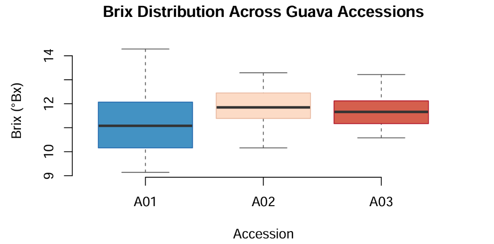

# Guava Accessions Analysis

## 1. Project Overview

This project explores fruit characteristics across three simulated guava accessions using R. The analysis focuses on understanding variation in physical and quality-related traits and comparing their average values.

The project is based on an agricultural research scenario in which fruit measurements can help support decisions about which accessions may be worth further evaluation.

## 2. Business Problem

In crop improvement and agricultural research, comparing fruit characteristics is an important step when evaluating different accessions.

The main objective was to explore the variation among three guava accessions and assess whether their average Brix levels differed significantly. The analysis also examined relationships between fruit weight, dimensions, and other measured traits.

## 3. Dataset

The dataset contains 75 simulated fruit observations, with 25 observations for each accession (A01, A02, and A03).

It includes the following variables:

- Fruit weight
- Fruit length and width
- Peel color
- Brix (soluble solids)
- Firmness
- Seed count

A fruit shape index was also calculated using fruit length divided by fruit width.

**Note:** The dataset is simulated for portfolio and learning purposes. It does not contain original experimental records.

## 4. Methodology

The analysis was carried out in R and included:

- Data preparation and validation, including checks for missing values and duplicates.
- Exploratory data analysis and descriptive statistics.
- Comparison of average fruit characteristics across accessions.
- One-way ANOVA and assessment of its assumptions.
- Welch's ANOVA to account for unequal variances.
- Tukey and Games–Howell post-hoc comparisons.
- Correlation analysis to explore relationships between numerical variables.
- Data visualization using consistent color palettes.

## 5. Key Findings

- A01 had the highest average fruit weight (180.45 g).
- A02 showed the highest average Brix value (11.92).
- Fruit weight had moderate positive correlations with fruit length (r = 0.58) and width (r = 0.60).
- Bartlett's test indicated unequal variances across accessions. Therefore, Welch's ANOVA and Games–Howell comparisons were considered more appropriate for the final statistical assessment.
- Welch's ANOVA did not show a statistically significant difference in average Brix levels among the three accessions (p = 0.0968). Games–Howell comparisons also found no significant pairwise differences.

These findings describe the simulated dataset and should not be interpreted as evidence of actual genetic differences between guava accessions.

## 6. Skills Demonstrated

- R programming
- Data cleaning and validation
- Exploratory data analysis (EDA)
- Descriptive statistics
- Statistical hypothesis testing
- ANOVA and post-hoc analysis
- Correlation analysis
- Data visualization
- Interpretation of statistical results
